<a href="https://monishat-portfolio.web.app/">
<picture>
  <source media="(max-width: 565px) and (prefers-color-scheme: dark), (min-width: 768px) and (max-width: 877px) and (prefers-color-scheme: dark)" srcset="./assets/m-hero-dark.svg" />
  <source media="(max-width: 565px), (min-width: 768px) and (max-width: 877px)" srcset="./assets/m-hero-light.svg" />
  <source media="(min-width: 566px) and (max-width: 767px) and (prefers-color-scheme: dark), (min-width: 878px) and (max-width: 1161px) and (prefers-color-scheme: dark)" srcset="./assets/t-hero-dark.svg" />
  <source media="(min-width: 566px) and (max-width: 767px), (min-width: 878px) and (max-width: 1161px)" srcset="./assets/t-hero-light.svg" />
  <source media="(prefers-color-scheme: dark)" srcset="./assets/hero-dark.svg" />
  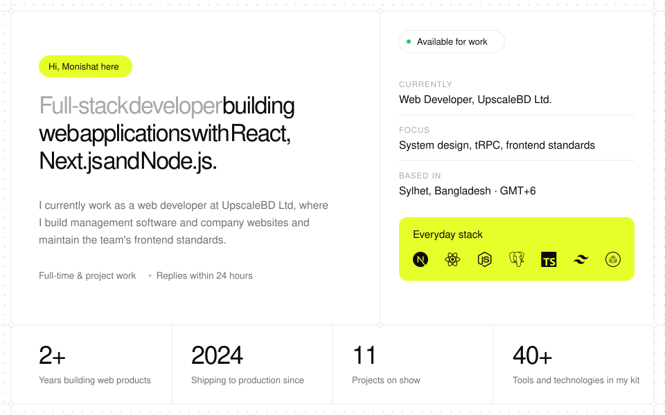
</picture>
</a>

  <a href="https://monishat-portfolio.web.app/"><picture><source media="(prefers-color-scheme: dark)" srcset="./assets/btn-portfolio-dark.svg" /></picture></a>
  <a href="https://www.linkedin.com/in/monishat-baishnab666"><picture><source media="(prefers-color-scheme: dark)" srcset="./assets/btn-linkedin-dark.svg" />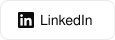</picture></a>
  <a href="mailto:baishnabmonishat@gmail.com"><picture><source media="(prefers-color-scheme: dark)" srcset="./assets/btn-email-dark.svg" />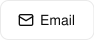</picture></a>
  <a href="https://drive.google.com/file/d/1Sd6SPfHb0_P3RUroWm0ScvdVXtaIvVGZ/view?usp=sharing"><picture><source media="(prefers-color-scheme: dark)" srcset="./assets/btn-cv-dark.svg" />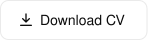</picture></a>

 

<picture>
  <source media="(max-width: 565px) and (prefers-color-scheme: dark), (min-width: 768px) and (max-width: 877px) and (prefers-color-scheme: dark)" srcset="./assets/m-head-about-dark.svg" />
  <source media="(max-width: 565px), (min-width: 768px) and (max-width: 877px)" srcset="./assets/m-head-about-light.svg" />
  <source media="(min-width: 566px) and (max-width: 767px) and (prefers-color-scheme: dark), (min-width: 878px) and (max-width: 1161px) and (prefers-color-scheme: dark)" srcset="./assets/t-head-about-dark.svg" />
  <source media="(min-width: 566px) and (max-width: 767px), (min-width: 878px) and (max-width: 1161px)" srcset="./assets/t-head-about-light.svg" />
  <source media="(prefers-color-scheme: dark)" srcset="./assets/head-about-dark.svg" />
  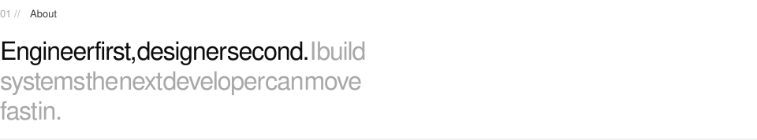
</picture>

I build full-stack web products with modern JavaScript - most often **React** and **Next.js** on the front, **Node**, **MongoDB** and **PostgreSQL** behind it. My favourite work lives where engineering meets craft: instrumented codebases, snappy interfaces, and small teams shipping fast without leaving the future a mess.

Over the past two years I've shipped a learning platform's course and payment interfaces, and now build management software and company sites at **UpscaleBD Ltd.** - along with the component library and frontend standards the team works from.

**Focus right now** &nbsp;·&nbsp; System design &nbsp;·&nbsp; tRPC integration &nbsp;·&nbsp; Frontend standards &nbsp;·&nbsp; Database design &nbsp;·&nbsp; Backend development

 

<picture>
  <source media="(max-width: 565px) and (prefers-color-scheme: dark), (min-width: 768px) and (max-width: 877px) and (prefers-color-scheme: dark)" srcset="./assets/m-head-experience-dark.svg" />
  <source media="(max-width: 565px), (min-width: 768px) and (max-width: 877px)" srcset="./assets/m-head-experience-light.svg" />
  <source media="(min-width: 566px) and (max-width: 767px) and (prefers-color-scheme: dark), (min-width: 878px) and (max-width: 1161px) and (prefers-color-scheme: dark)" srcset="./assets/t-head-experience-dark.svg" />
  <source media="(min-width: 566px) and (max-width: 767px), (min-width: 878px) and (max-width: 1161px)" srcset="./assets/t-head-experience-light.svg" />
  <source media="(prefers-color-scheme: dark)" srcset="./assets/head-experience-dark.svg" />
  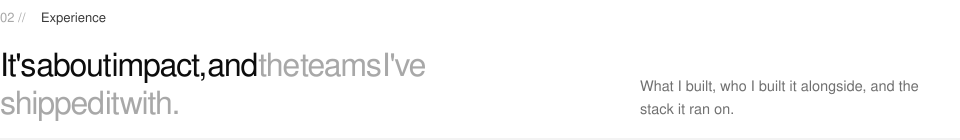
</picture>

 

<picture>
  <source media="(max-width: 565px) and (prefers-color-scheme: dark), (min-width: 768px) and (max-width: 877px) and (prefers-color-scheme: dark)" srcset="./assets/m-experience-dark.svg" />
  <source media="(max-width: 565px), (min-width: 768px) and (max-width: 877px)" srcset="./assets/m-experience-light.svg" />
  <source media="(min-width: 566px) and (max-width: 767px) and (prefers-color-scheme: dark), (min-width: 878px) and (max-width: 1161px) and (prefers-color-scheme: dark)" srcset="./assets/t-experience-dark.svg" />
  <source media="(min-width: 566px) and (max-width: 767px), (min-width: 878px) and (max-width: 1161px)" srcset="./assets/t-experience-light.svg" />
  <source media="(prefers-color-scheme: dark)" srcset="./assets/experience-dark.svg" />
  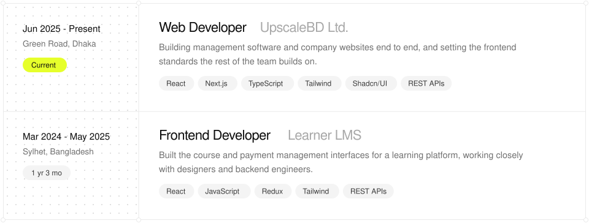
</picture>

  

<picture>
  <source media="(max-width: 565px) and (prefers-color-scheme: dark), (min-width: 768px) and (max-width: 877px) and (prefers-color-scheme: dark)" srcset="./assets/m-head-work-dark.svg" />
  <source media="(max-width: 565px), (min-width: 768px) and (max-width: 877px)" srcset="./assets/m-head-work-light.svg" />
  <source media="(min-width: 566px) and (max-width: 767px) and (prefers-color-scheme: dark), (min-width: 878px) and (max-width: 1161px) and (prefers-color-scheme: dark)" srcset="./assets/t-head-work-dark.svg" />
  <source media="(min-width: 566px) and (max-width: 767px), (min-width: 878px) and (max-width: 1161px)" srcset="./assets/t-head-work-light.svg" />
  <source media="(prefers-color-scheme: dark)" srcset="./assets/head-work-dark.svg" />
  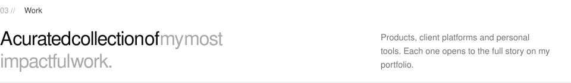
</picture>

 

  <a href="https://monishat-portfolio.web.app/work/hrx"><picture><source media="(prefers-color-scheme: dark)" srcset="./assets/work/hrx-dark.webp" />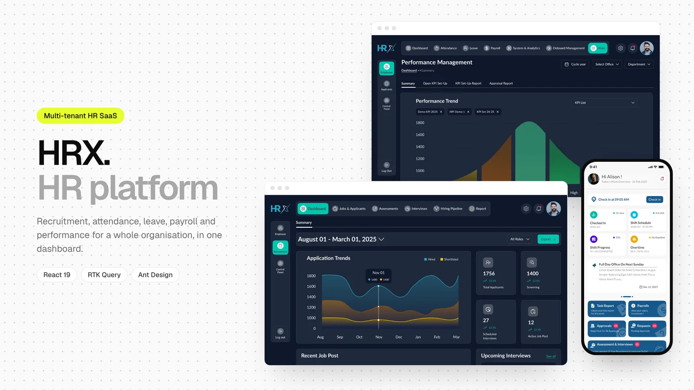</picture></a>
  <a href="https://monishat-portfolio.web.app/work/payroll"><picture><source media="(prefers-color-scheme: dark)" srcset="./assets/work/payroll-dark.webp" />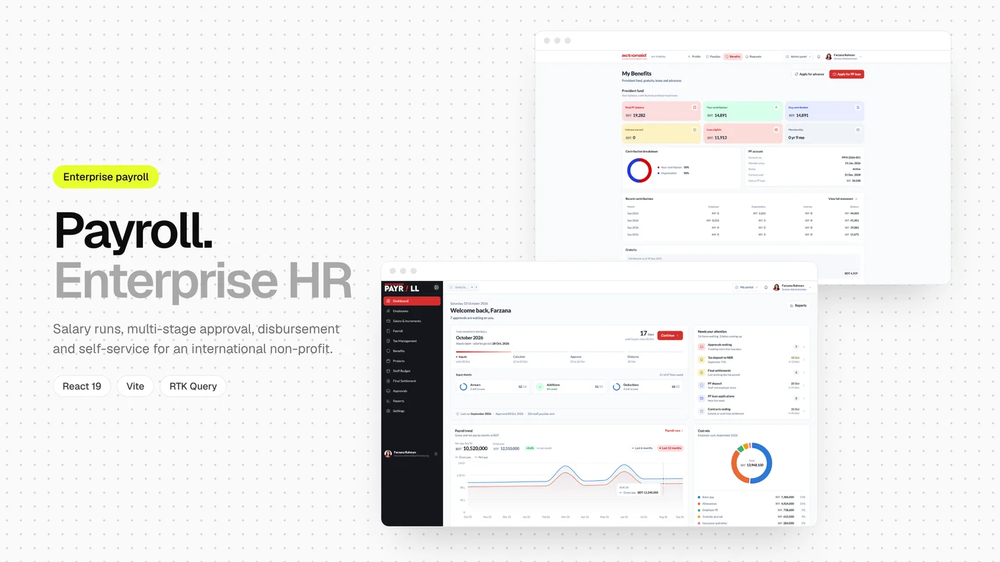</picture></a>

  <a href="https://monishat-portfolio.web.app/work/renpos"><picture><source media="(prefers-color-scheme: dark)" srcset="./assets/work/renpos-dark.webp" />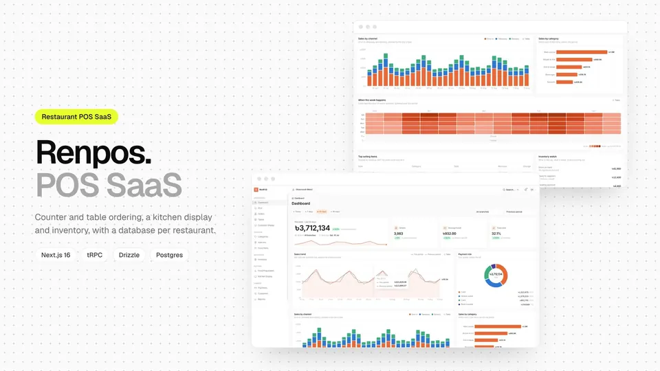</picture></a>
  <a href="https://monishat-portfolio.web.app/work/pawna"><picture><source media="(prefers-color-scheme: dark)" srcset="./assets/work/pawna-dark.webp" />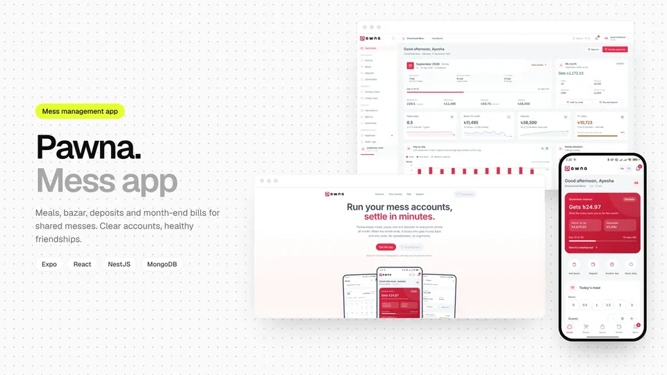</picture></a>

- **[HRX](https://monishat-portfolio.web.app/work/hrx)** - Multi-tenant HR platform for UpscaleBD. 20 modules, 273 API endpoints, 268 of 495 commits mine.
- **[Payroll Platform](https://monishat-portfolio.web.app/work/payroll)** - Enterprise payroll for ActionAid Bangladesh, as sole frontend engineer. 28 modules, 39 screens.
- **[Renpos](https://monishat-portfolio.web.app/work/renpos)** - Multi-tenant restaurant POS with a Postgres database per restaurant. 40 tables, 53 permission keys.
- **[Pawna](https://monishat-portfolio.web.app/work/pawna)** - My own product: mess accounts, settled every month. Web app, Android app and one API. [pawna.xyz](https://pawna.xyz)

<a href="https://monishat-portfolio.web.app/#work"><b>See all 11 projects →</b></a>

<picture>
  <source media="(max-width: 565px) and (prefers-color-scheme: dark), (min-width: 768px) and (max-width: 877px) and (prefers-color-scheme: dark)" srcset="./assets/m-head-toolkit-dark.svg" />
  <source media="(max-width: 565px), (min-width: 768px) and (max-width: 877px)" srcset="./assets/m-head-toolkit-light.svg" />
  <source media="(min-width: 566px) and (max-width: 767px) and (prefers-color-scheme: dark), (min-width: 878px) and (max-width: 1161px) and (prefers-color-scheme: dark)" srcset="./assets/t-head-toolkit-dark.svg" />
  <source media="(min-width: 566px) and (max-width: 767px), (min-width: 878px) and (max-width: 1161px)" srcset="./assets/t-head-toolkit-light.svg" />
  <source media="(prefers-color-scheme: dark)" srcset="./assets/head-toolkit-dark.svg" />
  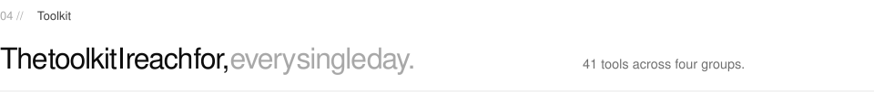
</picture>

 

<picture>
  <source media="(max-width: 565px) and (prefers-color-scheme: dark), (min-width: 768px) and (max-width: 877px) and (prefers-color-scheme: dark)" srcset="./assets/m-toolkit-dark.svg" />
  <source media="(max-width: 565px), (min-width: 768px) and (max-width: 877px)" srcset="./assets/m-toolkit-light.svg" />
  <source media="(min-width: 566px) and (max-width: 767px) and (prefers-color-scheme: dark), (min-width: 878px) and (max-width: 1161px) and (prefers-color-scheme: dark)" srcset="./assets/t-toolkit-dark.svg" />
  <source media="(min-width: 566px) and (max-width: 767px), (min-width: 878px) and (max-width: 1161px)" srcset="./assets/t-toolkit-light.svg" />
  <source media="(prefers-color-scheme: dark)" srcset="./assets/toolkit-dark.svg" />
  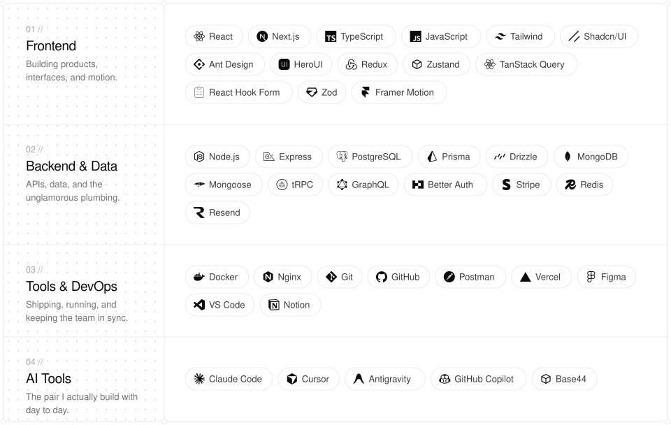
</picture>

  

<picture>
  <source media="(max-width: 565px) and (prefers-color-scheme: dark), (min-width: 768px) and (max-width: 877px) and (prefers-color-scheme: dark)" srcset="./assets/m-head-activity-dark.svg" />
  <source media="(max-width: 565px), (min-width: 768px) and (max-width: 877px)" srcset="./assets/m-head-activity-light.svg" />
  <source media="(min-width: 566px) and (max-width: 767px) and (prefers-color-scheme: dark), (min-width: 878px) and (max-width: 1161px) and (prefers-color-scheme: dark)" srcset="./assets/t-head-activity-dark.svg" />
  <source media="(min-width: 566px) and (max-width: 767px), (min-width: 878px) and (max-width: 1161px)" srcset="./assets/t-head-activity-light.svg" />
  <source media="(prefers-color-scheme: dark)" srcset="./assets/head-activity-dark.svg" />
  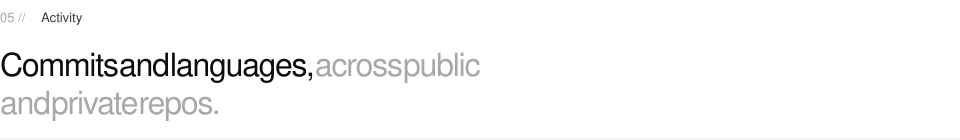
</picture>

 

  <picture>
    <source media="(prefers-color-scheme: dark)" srcset="https://github-readme-streak-stats-salesp07.vercel.app/?user=monishatBaishnab&count_private=true&border_radius=12&background=0A0A0A&border=222222&stroke=222222&ring=E6FF2B&fire=E6FF2B&currStreakNum=F5F5F5&sideNums=F5F5F5&currStreakLabel=F5F5F5&sideLabels=969696&dates=606060" />
    
  </picture>
  <picture>
    <source media="(prefers-color-scheme: dark)" srcset="https://github-readme-stats-salesp07.vercel.app/api/top-langs/?username=monishatBaishnab&hide=HTML%2CHack&langs_count=8&layout=compact&border_radius=12&size_weight=0.5&count_weight=0.5&exclude_repo=github-readme-stats&bg_color=0A0A0A&title_color=F5F5F5&text_color=969696&border_color=222222" />
    
  </picture>

 

<a href="mailto:baishnabmonishat@gmail.com">
<picture>
  <source media="(max-width: 565px) and (prefers-color-scheme: dark), (min-width: 768px) and (max-width: 877px) and (prefers-color-scheme: dark)" srcset="./assets/m-contact-dark.svg" />
  <source media="(max-width: 565px), (min-width: 768px) and (max-width: 877px)" srcset="./assets/m-contact-light.svg" />
  <source media="(min-width: 566px) and (max-width: 767px) and (prefers-color-scheme: dark), (min-width: 878px) and (max-width: 1161px) and (prefers-color-scheme: dark)" srcset="./assets/t-contact-dark.svg" />
  <source media="(min-width: 566px) and (max-width: 767px), (min-width: 878px) and (max-width: 1161px)" srcset="./assets/t-contact-light.svg" />
  <source media="(prefers-color-scheme: dark)" srcset="./assets/contact-dark.svg" />
  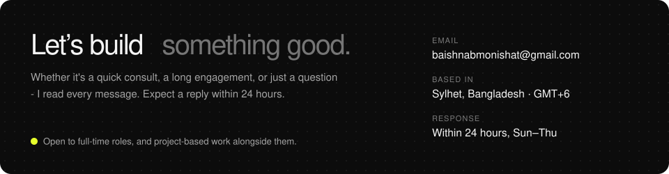
</picture>
</a>

  
    <a href="mailto:baishnabmonishat@gmail.com">baishnabmonishat@gmail.com</a> &nbsp;·&nbsp;
    <a href="https://www.linkedin.com/in/monishat-baishnab666">LinkedIn</a> &nbsp;·&nbsp;
    <a href="https://monishat-portfolio.web.app/">monishat-portfolio.web.app</a>
  

